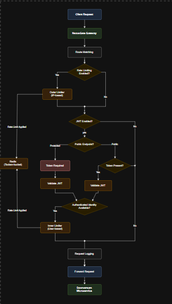
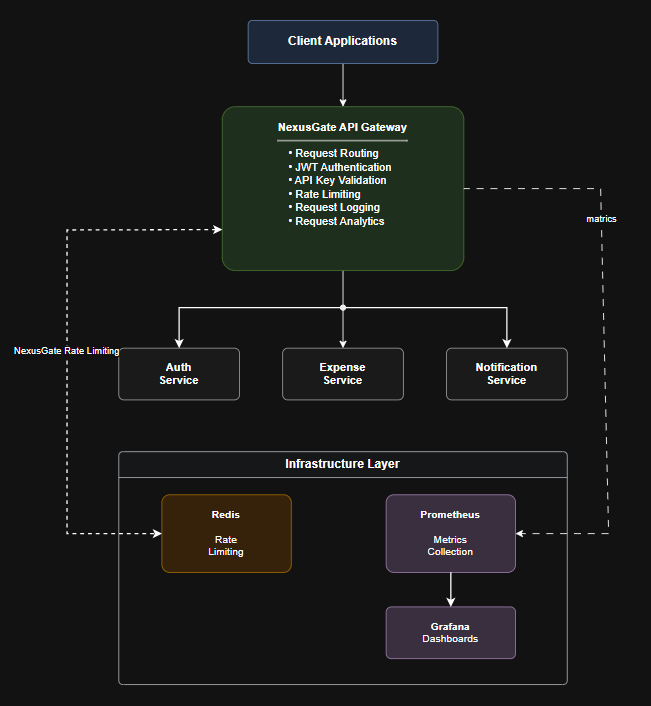

## NexusGate – Developer-Focused API Gateway

NexusGate is a self-hosted, configuration-driven API Gateway built with Java, Spring Boot, and Spring Cloud Gateway.

It provides a centralized entry point for client applications, handling request routing, JWT authentication, Redis-backed rate limiting, request logging, and monitoring.

Designed for developers, small teams, and personal projects, NexusGate provides essential API gateway capabilities through a YAML-based configuration, without requiring a complex infrastructure setup.
## 📋 Table of Contents

- [Overview](#overview)
- [Features](#features)
- [Architecture](#architecture)
- [Prerequisites](#prerequisites)
- [Installation and setup](#installation-and-setup)
  - [Clone the repository](#clone-the-repository)
  - [Verify Java](#verify-java)
  - [Build the project](#build-the-project)
- [Configuration](#configuration)
  - [Example configuration](#example-configuration)
  - [Gateway service configuration](#gateway-service-configuration)
  - [Management endpoint configuration](#management-endpoint-configuration)
  - [Security toggle and JWT verification configuration](#security-toggle-and-jwt-verification-configuration)
  - [Logging configuration](#logging-configuration)
  - [Monitoring configuration](#monitoring)
- [Rate limiting](#rate-limiting)
  - [Master switch](#master-switch)
  - [Redis failure strategy](#redis-failure-strategy)
  - [Redis timeout](#redis-timeout)
  - [Outer and inner limiters](#outer-and-inner-limiters)
  - [Token bucket behavior](#token-bucket-behavior)
  - [Redis behavior](#redis-behavior)
  - [Client-visible rate-limit responses](#client-visible-rate-limit-responses)
- [Public endpoints](#public-endpoints)
- [Project structure](#project-structure)
- [Running the application](#running-the-application)
- [API routing examples](#api-routing-examples)
- [Testing](#testing)
- [Support](#support)

## 🎯 Overview

**NexusGate** acts as the centralized entry point for applications communicating with multiple downstream services.
- **Reverse proxy and request routing** to downstream microservices
- **YAML-based service configuration** for flexible deployment
- **Security master switch** to enable or disable all gateway security checks
- **JWT authentication** with configurable identity claims and optional per-service public endpoints
- **rate limiting** Redis-backed token-bucket rate limiting
- **Service-specific public endpoints** with optional JWT verification
- **Centralized management endpoint routing** with per-service overrides
- **Request logging** with configurable fields and request IDs
- **Principal propagation** via `X-Principal` headers with spoofing protection
- **Monitoring**: basic metrics collection using a custom metric registry and a Prometheus scrape endpoint (configurable via `nexus.yml`)

The gateway is built using **Spring Cloud Gateway** with reactive (WebFlux) programming model for handling high-throughput asynchronous requests efficiently.

### ⚠️ Important Note: Responsibility Boundaries

**NexusGate is an API Gateway and reverse proxy.** The example services and ports (Auth Service on port 8081, Product Service on port 8083, Order Service on port 8082) shown throughout this documentation are **for development and debugging purposes only**.

**Critical Responsibilities:**

- **NexusGate handles**:  Request routing, reverse proxying, JWT verification, issuer/audience validation, identity extraction, principal propagation, and centralized gateway-level policies
- **Auth Service handles**: Access token generation, refresh token validation, token expiration management, and new token issuance
- **Your responsibility**: Implement, maintain, and configure the Auth Service according to your security requirements

**NexusGate does NOT generate, issue, or manage tokens.** The Auth Service is a separate microservice that you must develop, deploy, and configure.

## Features

- API gateway and reverse proxy for downstream services
- YAML-based service configuration via `nexus.yml`
- per-service public endpoint configuration
- global `security.enabled` master switch and nested `security.jwt.enabled` verification toggle
- JWT validation with configurable `identityClaim`
- management endpoint routing through `/management` to each service's actuator endpoint
- Redis-backed token-bucket rate limiting with a master enable/disable switch
- separate outer IP-based and inner user-based limiters
- fail-open / fail-closed Redis behavior with configurable timeout
- HTTP 429 responses, `Retry-After`, and `X-RateLimit-*` headers
- request logging with selectable fields and request ID propagation
- monitoring with a custom metric registry and Prometheus scrape endpoint
  - `monitoring.enabled` master switch to enable/disable all gateway metrics
  - Prometheus exporter exposure via configurable scrape path and config file
- reactive Spring Cloud Gateway implementation

## Architecture
NexusGate follows a centralized API Gateway architecture,
providing a single entry point for client applications.

### 1. Request Processing Architecture

This diagram illustrates how incoming requests are processed
by NexusGate, including routing, authentication, rate limiting,
logging, and forwarding.


### 2. Infrastructure Architecture



## Prerequisites

- Java 21
- Gradle 8.x
- Git
- An Auth Service that issues access tokens and handles refresh-token flows
- Redis only when `rateLimit.enabled=true`
- Downstream services running on the configured URLs

The service ports used in examples such as `http://localhost:8081`, `http://localhost:8082`, and `http://localhost:8083` are only sample values for local development.

## Installation and setup

### Clone the repository

```bash
git clone https://github.com/ByteGitAccnt/NexusGate.git
cd NexusGate
```

### Verify Java

```bash
java -version
javac -version
```

### Build the project

```bash
./gradlew build
```

Windows:

```bash
./gradlew.bat build
```

## Configuration

NexusGate reads its routing and security configuration from `nexus.yml`. The file defines:

- downstream services and their routed paths
- public endpoints that allow optional JWT authentication
- JWT verification settings
- management endpoint exposure settings
- Redis configuration
- rate-limit configuration

See [Configuration Guide](./src/main/java/com/nexusgate/nexus_gateway/docs/configuration.md) for the detailed reference.

### Example configuration

```yaml
services:
  auth:
    url: http://localhost:8081
    path: /api/v1/auth/**
    publicEndpoints:
      - /login
      - /register
      - /refresh

  product:
    url: http://localhost:8083
    path: /api/v1/product/**
    management:
      endpoints:
        - health

  order:
    url: http://localhost:8082
    path: /api/v1/order/**
    management:
      endpoints:
        - metrics

management:
  enabled: true
  basePath: /management
  targetPath: /actuator
  endpoints:
    - health
    - info

security:
  enabled: true
  jwt:
    enabled: true
    algorithm: HS256
    identityClaim: userid
    verification:
      type: shared-secret
      secret: ${JWT_SECRET}
    issuer: http://localhost:8081
    audience: nexusgate

rateLimit:
  enabled: true
  redisFailureStrategy: fail-closed
  redisTimeoutMs: 1000

  outer:
    enabled: true
    algorithm: token-bucket
    capacity: 100
    refillRate: 100
    refillPeriodSeconds: 60

  inner:
    enabled: true
    algorithm: token-bucket
    capacity: 100
    refillRate: 100
    refillPeriodSeconds: 60

logging:
  enabled: true
  fields:
    timestamp: true
    method: true
    path: true
    service: true
    status: true
    duration: true
    requestId: true
    clientIp: true

monitoring:
  enabled: true

redis:
  host: ${REDIS_HOST}
  port: ${REDIS_PORT}
```

### Gateway service configuration

The `services` section defines the downstream services known to NexusGate.

- `url`: the destination URL of the downstream service
- `path`: the proxied path pattern, such as `/api/v1/product/**`
- `publicEndpoints`: endpoints that are accessible without JWT authentication
- `management.endpoints`: per-service allowed actuator endpoints

### Management endpoint configuration

The `management` block controls access to downstream Spring Boot Actuator endpoints.

```yaml
management:
  enabled: true
  basePath: /management
  targetPath: /actuator
  endpoints:
    - health
    - info
```

This allows NexusGate to expose management routes such as:

```text
/management/product/health
```

and rewrite the request to the downstream actuator path:

```text
/actuator/health
```

### Security toggle and JWT verification configuration

```yaml
security:
  enabled: true
  jwt:
    enabled: true
    algorithm: HS256
    identityClaim: userid
    verification:
      type: shared-secret
      secret: ${JWT_SECRET}
    issuer: http://localhost:8081
    audience: nexusgate
```

### Security Configuration

NexusGate provides configurable JWT authentication through two security switches.

- **`security.enabled`** acts as the master switch for gateway security enforcement. When set to `false`, the JWT gateway filter is not activated, and the gateway skips JWT enforcement for protected routes.
- **`security.jwt.enabled`** controls JWT verification independently within the broader security configuration. When set to `false`, JWT verification is disabled even if the master security switch remains enabled.

The effective behaviour is determined by both settings:

| `security.enabled` | `security.jwt.enabled` | Behaviour |
|---|---|---|
| `false` | `true` | Security enforcement is disabled |
| `false` | `false` | Security enforcement is disabled |
| `true` | `false` | JWT verification is disabled |
| `true` | `true` | JWT verification is active |

When JWT verification is enabled, NexusGate:

1. Validates the JWT signature.
2. Verifies the expected issuer and audience values.
3. Extracts the configured identity claim.
4. Uses the extracted identity as the authenticated principal as `X-Principal` for downstream propagation.

**Token Management Responsibility**

NexusGate is responsible for validating incoming access tokens, not issuing or managing them.

The Auth Service handles:
- Access token generation and issuance.
- Refresh token validation.
- Token expiration management.
- Refresh token rotation and new access token issuance.

NexusGate and the Auth Service therefore have separate security responsibilities: the Auth Service issues tokens, while NexusGate validates them before forwarding authenticated requests to downstream services.
### Logging configuration

```yaml
logging:
  enabled: true
  fields:
    timestamp: true
    method: true
    path: true
    service: true
    status: true
    duration: true
    requestId: true
    clientIp: true
```

The logging block turns gateway request logging on or off. When `logging.enabled` is `false`, the gateway skips the global logging filter entirely. Each field under `logging.fields` is independently configurable, allowing you to emit only the request metadata you need while keeping log output concise.

The gateway also assigns and propagates an `X-Request-ID` header for request correlation, and logs the downstream route/service name when available.

### Monitoring

NexusGate supports basic metrics collection controlled by a single master switch in nexus.yml:

```yaml
monitoring:
  enabled: true
```

When `monitoring.enabled` is `true`, the gateway initializes its metric collection and exposes a Prometheus scrape endpoint at /actuator/prometheus (default). A sample Prometheus configuration for local testing is included at src/main/resources/prometheus.yml. Advanced metric registry wiring (custom metric registry and exporter behavior) is implemented in code and not currently exposed as nested keys in nexus.yml.

## Rate limiting

NexusGate supports Redis-backed rate limiting with a master switch.

```yaml
rateLimit:
  enabled: true
  redisFailureStrategy: fail-closed
  redisTimeoutMs: 1000

  outer:
    enabled: true
    algorithm: token-bucket
    capacity: 100
    refillRate: 100
    refillPeriodSeconds: 60

  inner:
    enabled: true
    algorithm: token-bucket
    capacity: 60
    refillRate: 60
    refillPeriodSeconds: 60
```

Note: The numeric and timing values shown above (capacity, refillRate, refillPeriodSeconds, redisTimeoutMs, etc.) are development/debug defaults for local testing only. Tune these values according to production traffic patterns and infrastructure before deployment.

### Master switch

`rateLimit.enabled` controls the entire rate-limit subsystem.

If it is `false`:

- the gateway does not initialize Redis-based rate limiting
- Redis becomes an optional infrastructure dependency
- requests are not rate limited by NexusGate

If it is `true`:

- the gateway uses Redis for rate-limit state
- Redis is required because the rate-limit buckets are stored there

### Redis failure strategy

`redisFailureStrategy` controls behavior during runtime Redis outages.

- `fail-closed`: rate-limiting cannot complete, so the request is rejected with `503 Service Unavailable`
- `fail-open`: Redis is unavailable, so the gateway temporarily bypasses rate limiting and allows the request through

This setting affects runtime failure only. It does not make Redis optional when `rateLimit.enabled=true`.

### Redis timeout

`redisTimeoutMs` defines how long the gateway waits for a Redis call before treating it as a failure. The current value is 1000 ms.

### Outer and inner limiters

NexusGate supports two independent token bucket stages:

- outer limiter: IP-based, keyed by client IP
- inner limiter: user-based, keyed by authenticated identity

The current configuration enables both the outer limiter and the inner limiter.

The outer limiter is useful as a gateway-level protection layer before user identity is known. The inner limiter uses the JWT identity claim and keeps separate buckets per authenticated user.

### Token bucket behavior

Both outer and inner limiters use the token-bucket algorithm.

- `capacity`: maximum number of tokens in the bucket
- `refillRate`: number of tokens replenished per refill period
- `refillPeriodSeconds`: length of the refill window

Tokens are calculated lazily when a request arrives, rather than by running a background refill job.

### Redis behavior

Redis connection details are supplied through environment variables:

```yaml
redis:
  host: ${REDIS_HOST}
  port: ${REDIS_PORT}
```

The Redis client is managed through Spring's Redis infrastructure. When rate limiting is enabled, Redis is required. When disabled, the gateway avoids initializing Redis-backed rate limiter support.

Lettuce can continue reconnecting in the background when Redis becomes available again after a temporary outage.

### Client-visible rate-limit responses

When the rate limit is active, NexusGate exposes headers such as:

```text
X-RateLimit-Limit
X-RateLimit-Remaining
```

If a bucket is exhausted, the request is rejected with:

```text
HTTP 429 Too Many Requests
Retry-After: <seconds>
```

Example:

```text
X-RateLimit-Limit: 6
X-RateLimit-Remaining: 0
Retry-After: 54
```

## Public endpoints

A service may declare public endpoints that do not require JWT authentication.

```yaml
services:
  auth:
    url: http://localhost:8081
    path: /api/v1/auth/**
    publicEndpoints:
      - /login
      - /register
      - /refresh
```

Public endpoints can be accessed without a token. If a client provides a Bearer token on a public endpoint, NexusGate still validates it. An invalid or malformed token is rejected with `401 Unauthorized`.

## Project structure

```text
Directory structure:
└── nexus-gateway/
    ├── README.md
    ├── compose.monitoring.yml
    ├── compose.standalone-monitoring.yml
    ├── compose.yml
    ├── Dockerfile
    ├── gradlew
    ├── gradlew.bat
    ├── nexus.yml
    ├── .dockerignore
    ├── .env.example
    ├── docs/
    │   └── configuration.md
    ├── gradle/
    │   └── wrapper/
    │       └── gradle-wrapper.properties
    ├── monitoring/
    │   ├── grafana/
    │   │   ├── dashboards/
    │   │   │   └── NexusGate-Grafana-Dashboard.json
    │   │   └── provisioning/
    │   │       ├── dashboards/
    │   │       │   └── dashboards.yml
    │   │       └── datasources/
    │   │           └── prometheus.yml
    │   └── prometheus/
    │       └── prometheus.yml
    └── src/
        ├── main/
        │   ├── java/
        │   │   └── com/
        │   │       └── nexusgate/
        │   │           └── nexus_gateway/
        │   │               ├── NexusGatewayApplication.java
        │   │               ├── Config/
        │   │               │   ├── EnvironmentVariableResolver.java
        │   │               │   ├── NexusConfig.java
        │   │               │   ├── NexusConfigLoader.java
        │   │               │   ├── NexusEnvironmentPostProcessor.java
        │   │               │   ├── NexusRouteBuilder.java
        │   │               │   ├── NexusSpringConfig.java
        │   │               │   ├── SecurityConfig.java
        │   │               │   ├── ServiceConfig.java
        │   │               │   ├── Logging/
        │   │               │   │   ├── LoggingConfig.java
        │   │               │   │   └── LoggingFields.java
        │   │               │   ├── management/
        │   │               │   │   ├── ManagementConfig.java
        │   │               │   │   └── ManagementServiceConfig.java
        │   │               │   ├── Monitoring/
        │   │               │   │   └── MonitoringConfig.java
        │   │               │   ├── RateLimit/
        │   │               │   │   ├── ClientIpResolver.java
        │   │               │   │   ├── RateLimitConfig.java
        │   │               │   │   ├── RateLimitKeyGenerator.java
        │   │               │   │   ├── RateLimitPolicy.java
        │   │               │   │   ├── RateLimitResult.java
        │   │               │   │   └── RedisTokenBucket.java
        │   │               │   └── Security/
        │   │               │       ├── HmacJwtTokenVerifier.java
        │   │               │       ├── JwtConfig.java
        │   │               │       ├── JwtTokenVerifier.java
        │   │               │       ├── JwtVerificationConfig.java
        │   │               │       └── SecurityConfig.java
        │   │               ├── Filter/
        │   │               │   ├── InnerRateLimitGatewayFilterFactory.java
        │   │               │   ├── JwtAuthenticationGatewayFilterFactory.java
        │   │               │   ├── LoggingGatewayFilter.java
        │   │               │   ├── ManagementEndpointGatewayFilterFactory.java
        │   │               │   └── OuterRateLimitFilter.java
        │   │               └── Redis/
        │   │                   ├── NexusRedisAutoConfigurationFilter.java
        │   │                   ├── NexusRedisConnectionDetails.java
        │   │                   └── RedisConfig.java
        │   └── resources/
        │       ├── application.yaml
        │       ├── META-INF/
        │       │   └── spring.factories
        │       └── redis/
        │           └── token_bucket.lua
        └── test/

```

## Running the application

```bash
./gradlew bootRun
```

The gateway runs on the default Spring Boot port unless overridden:

```bash
./gradlew bootRun --args='--server.port=9000'
```

## API routing examples

```text
/api/v1/auth/**      → Auth Service
/api/v1/product/**   → Product Service
/api/v1/order/**     → Order Service
```

The actual downstream target depends on the `url` and `path` values in `nexus.yml`.

## Testing

```bash
./gradlew test
```

## Support

For gateway configuration questions, review `nexus.yml` and the configuration guide in `src/main/java/com/nexusgate/nexus_gateway/docs/configuration.md`.
